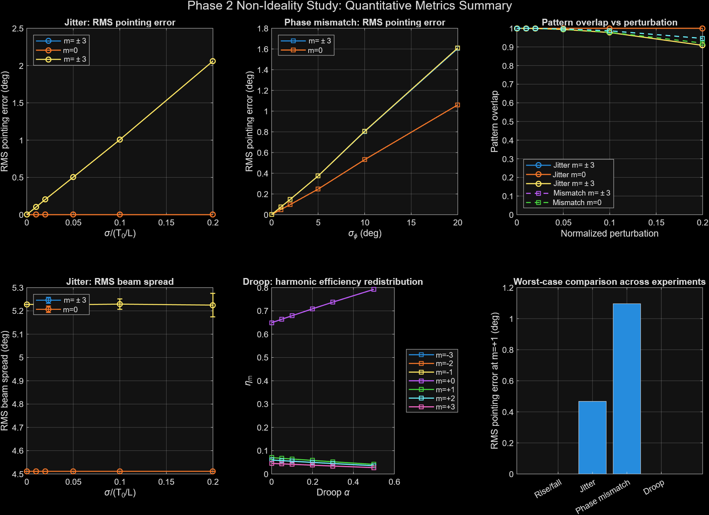

# Space-time-coding metasurfaces under non-ideal time modulation

MATLAB code from my undergraduate thesis (University of Sannio, supervised by Prof. Vincenzo Galdi).
It asks how robust a 1-bit space-time-coding metasurface (STCM) is when its time modulation is imperfect.

The array model uses the CST-extracted reflection coefficients of a 10 GHz PIN-diode unit cell
(|Γ0| = 0.911 at −102°, |Γ1| = 0.952 at 94°) and an 8-element time-gradient coding sequence,
following Zhang et al., *Nat. Commun.* 9, 4334 (2018).

## Contents

| Folder | Script | What it does |
|---|---|---|
| `phase1_baseline/` | `ideal_harmonic_beam_steering.m` | Fourier/array-factor engine; reproduces harmonic steering θ_m = arcsin(m/4) for m = −3…3 (error ≤ 0.02°) |
| | `am_vs_pm_baseline.m` | Ideal harmonic-efficiency reference and AM-vs-PM comparison (Fig. 2c–f of Zhang et al.) |
| `phase2_nonidealities/` | `risefalltime.m` | Finite diode switching time |
| | `jitter.m` | Per-element timing jitter (Monte Carlo) |
| | `temporalmismatch.m` | Phase / amplitude mismatch of the two states |
| | `waveform_distortion.m` | Waveform droop |
| | `non_ideality_run_composite.m` | All four non-idealities applied together |
| | `phase2_consolidated.m` | Harmonic efficiency, pointing error, RMS beam spread, peak sidelobe level and pattern overlap for every experiment |
| `appendix/` | `multibit_state_dependent_mismatch.m` | Checks that the jitter and common-phase sensitivities do not depend on bit depth; state-dependent mismatch for 2- and 3-bit STCMs |

Every script is self-contained (local functions only) and runs with base MATLAB:
open it and press Run. Monte Carlo scripts fix `rng` so results reproduce.

## Main findings (500 Monte Carlo realisations)

- Timing jitter dominates high-order beam-pointing error (≈10.28° per unit σ at m = ±3).
- Phase mismatch controls low-order accuracy.
- Droop limits harmonic efficiency.
- Amplitude mismatch is benign.
- At realistic diode, FPGA and PCB tolerances, the Zhang et al. prototype stays in the ideal regime.

## License
MIT
